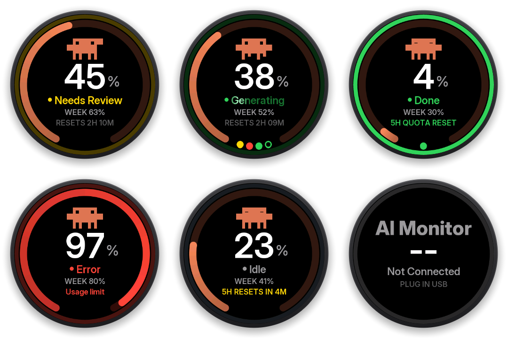
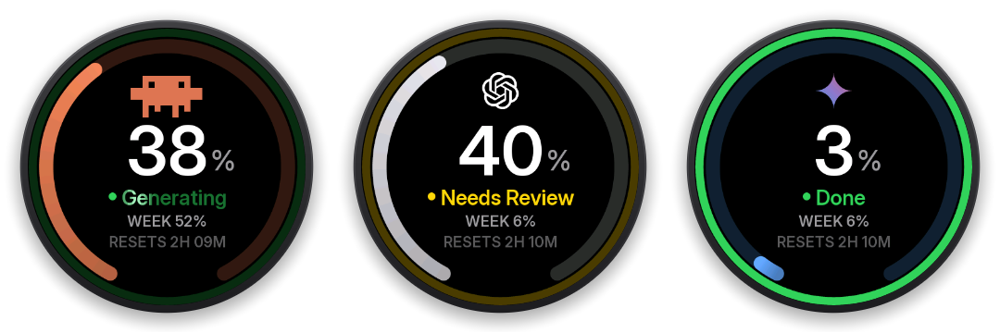
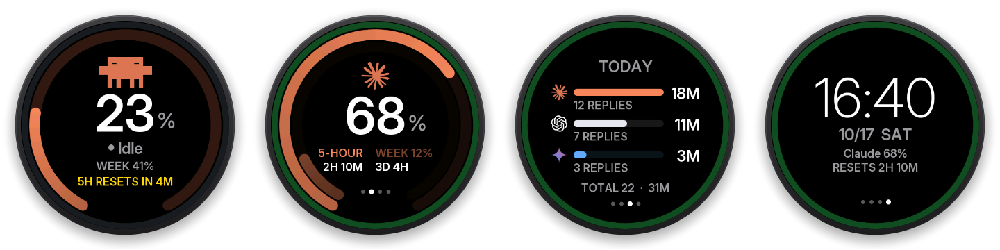

# AI 狀態指示燈（USB 版）

插上 USB 就能用：每台電腦第一次雙擊 `AIMonitor.exe`，之後插上螢幕就會自動顯示**你目前正在用的 AI**（Claude / ChatGPT / Gemini 桌面 App；網頁版要另外裝瀏覽器擴充功能），不需要 Wi-Fi。

<p align="center"></p>

Claude、ChatGPT、Gemini 都支援，最上面是目前顯示的 AI（官方 LOGO），額度環與數字是那一家的 5 小時額度：

<p align="center"></p>

各頁面（BOOT 短按切換，AMOLED 版左右滑：狀態 → 額度詳細 → 今日統計 → 時鐘）：

<p align="center"></p>

預覽圖是 1.75 吋 AMOLED 版（1.28 吋版版面相同，Claude 的位置是官方 LOGO、沒有 Clawd）。動態效果見 [demo.gif](docs/images/demo-v2.gif)。

Apple Watch 活動圓環風格：純黑底、Apple 系統配色、Inter 字型（抗鋸齒）。

| 最外圈細環（狀態燈） | 意義 |
|---|---|
| 🟢 綠色慢呼吸 | 正在生成 |
| 🟡 黃色快呼吸 | 網頁或 Claude Code 出現「允許 / 確認」，或 Claude 問你問題（選擇題、核准計畫、回覆結尾的問題），等你處理；問題類的長按 BOOT（AMOLED：按住螢幕）也能標為已讀 |
| 🟢 綠色恆亮（不呼吸） | 完成。在背景完成時，會一直亮到你切回去看（或長按 BOOT／按住螢幕） |
| 🔴 紅色雙閃 | 出現錯誤或額度上限訊息（Claude Code 會顯示 RATE LIMIT 等原因） |
| ⚪ 暗灰 | 待命 |

- **內圈**：5 小時額度，下方留一個開口（像儀表），從開口左側開始順時針增加，用量達到「額度重置提醒」的門檻時變紅（預設 90%；提醒關閉時不變紅）。中間的 `WEEK 63%` 是每週額度，最下面一行是 5 小時額度的重置倒數。
- **今日統計頁**：今天各 AI 生成了幾次、生成多久（不含等你按允許的時間），每天午夜歸零；設定視窗的「統計」分頁另有最近 7 天的長條圖。資料存在 `%LOCALAPPDATA%\AIMonitor\stats.json`。
- **額度詳細頁**：外環 5 小時（品牌色）、內環本週（暗一半的同色）。中間是官方 LOGO 與 5 小時用量，下面左右兩欄是 5-HOUR / WEEK 各自的重置倒數，標籤跟各自的環同色。
- **最上面的圖示**：目前顯示的 AI，用官方 LOGO（ChatGPT、Gemini；AMOLED 的 Claude 是會動的 Clawd，1.28 吋是 Claude 的官方 LOGO）。
- **中間大數字**：有額度資料時顯示用量 %；沒有時顯示這個狀態已經持續多久。
- **動態效果**：生成中的「Generating」有一道光由左往右掃過；額度變動時，內圈和數字花 3 秒慢慢跑到新的值，數字像里程表一樣一位一位往上捲；
  AMOLED 切換到另一個 AI 時畫面淡出淡入（不會撕裂），淡入的同時額度從上一家捲到這一家。
- **6 點鐘缺口的小圓點**：其他對話的狀態，排在額度環下方的缺口裡，最多 5 個，只用顏色表示：空心綠圈 = 生成中、綠點 = 完成、黃點 = 需審核、紅點 = 錯誤（要你處理的排在左邊）。
- **顯示哪一個 AI**：「你沒看到的事」優先，你正在看的對話自己看得到：
  1. 背景需審核 → 2. 正在看的需審核 → 3. 背景錯誤 → 4. 背景完成 → 5. 背景生成中 → 6. 正在看的生成中 → 7. 看過的錯誤 / 完成（亮 8 秒）→ 8. 待機。
  背景的錯誤和完成會一直亮，直到你切過去看或長按 BOOT（AMOLED：按住螢幕）；背景完成 1 分鐘後會讓位給生成中（你在別的對話來回聊時看得到呼吸燈），等沒有 AI 在跑時再回到主燈。其他狀態顯示在下方小圓點。你切到另一個 AI 的視窗時（例如從 Claude App 切到 Gemini 網頁），主燈跟著你看的那個 AI，只有需審核和錯誤會蓋過它。
- **螢幕方向**：設定視窗的「螢幕方向」可選 0° / 90° / 180° / 270°，螢幕會記住（下次插電直接是這個方向）。
  AMOLED 版預設依板上的陀螺儀**自動轉向**：立著擺、倒過來擺都會自己轉正，平放時維持原本的方向（方向選單選「自動（依擺放方向）」；選固定角度就關掉自動轉向）。
- **BOOT 鍵**：短按翻頁（狀態 → 額度詳細 → 今日統計 → 時鐘，20 秒後自動回到狀態頁）；長按 0.7 秒把綠燈、紅燈標為已讀。亮度在 AIMonitor 設定視窗調整。
  AMOLED 版用觸控操作（裝進外殼按不到 BOOT 鍵也沒關係）：**往左滑** = 下一頁、**往右滑** = 上一頁，內容會跟著滑過去（外圈燈號不動）；**按住螢幕**約 0.7 秒 = 標為已讀；點一下只會叫醒螢幕保護。
- **螢幕保護**：連續 5 分鐘待命（或未連線）會變成時鐘畫面並調暗背光，時鐘（連同日期和額度）整組置中，日期以數字顯示（例如 10/17 SAT）。外圈有一條細細的 5 小時額度弧（AMOLED 版只畫已用的部分）。AI 一開始生成、需要審核或出錯就會立刻回來，按 BOOT 鍵（AMOLED：點一下螢幕）也可以叫醒。AMOLED 版的螢幕保護裡，Clawd 會在畫面上到處亂跑。時間可以在 AIMonitor 設定視窗的「螢幕保護」選單調整（也可以關閉）；亮度在 `firmware/aimon/config.h` 的 `SAVER_BRIGHT`。

---

## 需要的硬體

| 項目 | 說明 |
|---|---|
| 螢幕板（二選一） | **ESP32-2424S012N**：ESP32-C3 + 1.28 吋圓形 IPS 螢幕（GC9A01，240×240）。網路商店搜尋「ESP32-2424S012」或「ESP32-C3 1.28 圓形螢幕」即可找到 |
| | **Waveshare ESP32-S3-Touch-AMOLED-1.75**：ESP32-S3 + 1.75 吋圓形 AMOLED（CO5300，466×466）。版面跟 1.28 吋一樣（等比例放大），黑色更黑，另外有觸控、自動轉向和會動的 Clawd |
| USB 線 | USB-C **傳輸線**（只能充電的線電腦抓不到裝置） |
| 電腦 | Windows 10 / 11（需要 WebView2，Windows 11 已內建） |

- 型號最後的 **N** 是無觸控版，本專案就是用這個版本開發與測試；觸控版（**C**）螢幕相同，但沒有實測過。
- 基本功能不需要焊接、不需要外接零件（外接 LED 是選配，見下方）：板子上的 **BOOT 鍵**就是操作按鈕（短按翻頁、長按標為已讀），**RST 鍵**用來重新開機。AMOLED 版用觸控操作，裝進外殼按不到 BOOT 鍵也沒關係。
- 不需要 Wi-Fi：螢幕的電源和資料都走同一條 USB。
- 兩種螢幕可以**同時接在同一台電腦**，顯示一樣的內容（例如一塊放桌上、一塊放螢幕旁）。方向、亮度、外接 LED、麥克風每塊各自設定（設定視窗用「調整哪塊螢幕」選單切換；只接一塊時不會出現。換 USB 孔也記得是哪一塊）。
- AMOLED 版：有用到觸控（左右滑換頁）、陀螺儀（自動轉向），可以選擇開啟板上的雙麥克風（見下方「AMOLED 當 USB 麥克風」）；電池、喇叭沒用到。主燈是 Claude 時，上方的名稱換成會動的像素小螃蟹 Clawd（生成中踏步、需審核揮手、完成跳一下、錯誤抖動、待命眨眼），螢幕保護時牠在畫面裡到處亂跑。整張畫面畫好才一次送出，換頁時不會一條一條出現。AMOLED 長時間顯示同樣的畫面會烙印，所以文字每 2 分鐘會挪動幾個像素（看不太出來）。

### AMOLED 當 USB 麥克風（選用）

AMOLED 板上有兩顆麥克風（ES7210 錄音晶片）。在設定視窗把那塊螢幕的「**麥克風**」改成「開啟」，電腦就會多一支 USB 麥克風「**AIMonitor Mic**」（48 kHz 立體聲），可以用 Windows 的語音輸入（Win+H）、Claude App 的語音模式等任何程式錄音。預設關閉。
收音太小聲或有爆音時，調整下面的「**麥克風增益**」（24-37.5 dB，預設 30 dB，馬上生效）。
有程式正在錄音時（例如按了 Win+H），螢幕的黑色背景會跟著你說話的大小聲淡淡亮起（主燈那家 AI 的顏色，越大聲越亮、範圍越大），沒在錄音就不亮，也順便提醒你麥克風正在被使用。

- 開啟時螢幕會換成另一個 USB 裝置（新的 COM 埠 + 麥克風），AIMonitor 自動認回同一塊螢幕，畫面照常顯示，約 2 秒。關閉時螢幕會重新開機回到一般模式。
- 平常開機一定是一般模式，開關記在 AIMonitor 裡、不存在螢幕上：AIMonitor 沒在執行時重開螢幕，麥克風就是關的。
- 開著麥克風時螢幕萬一當機，會自己重開回一般模式，而且這次開機先不開麥克風（設定視窗會顯示提醒；拔掉 USB 再插上會再試）。
- 一鍵更新韌體時會自動先關掉麥克風，更新完再照設定打開。
- 外殼記得在麥克風的位置開孔：板子背面、按鍵對面的邊上，上下各一顆。
- 需要韌體 1.10.15 以上。

### 選配：外接狀態 LED（WS2812）

想讓燈號從外殼透出來（例如透明 PETG 外殼），可以加一顆 WS2812 LED。它會跟外圈燈號同步：生成中綠色呼吸、需審核黃色快呼吸、錯誤紅色雙閃、完成綠色恆亮，待命和未連線時熄燈，螢幕保護時調暗。不加也完全不影響其他功能。

| 項目 | 說明 |
|---|---|
| LED | 單顆 WS2812B / SK6812 小模組（模組上通常已經有一顆 0.1µF 電容，標示 C1，不用另外加） |
| 線材 | SH1.0 4-pin 端子線，插板子背面的白色排座（絲印 GND / 3.3V / TX / RX） |

接線（只要焊 3 條）：

| LED 模組 | 背面排座 |
|---|---|
| DIN（箭頭進去那端，不是 DOUT） | **RX**（GPIO20） |
| VCC / 5V | **3.3V**（排座沒有 5V，單顆 LED 用 3.3V 就夠亮） |
| GND | GND |

AMOLED 版：DIN 接 8-pin 排座的 **GPIO16**，電源接排座的 **3V3** / **GND**。

- 不要接排座旁邊標 IO8 的圓形焊點：它是開機腳位，被拉低時「一鍵更新韌體」會進不了燒錄模式。
- 接好後在 AIMonitor 設定視窗把那塊螢幕的「外接 LED」從「關閉」改成「暗」或「中」（預設關閉），按「播放測試畫面」就能看到各種燈號。需要韌體 1.7.0 以上。
- LED 前面貼一小片霧面膠帶或描圖紙，光會比較均勻，不會只看到一個亮點。
- 3D 列印外殼（SolidWorks）設計中，在 [`enclosure/`](enclosure/)（1.28 吋 `lcd128/`、1.75 吋 `amoled175/`）。
- 只有透過板子內建 USB 連線時才會啟用（RX 腳在 CH340 版的板子上是通訊用的）。

## 一、燒錄韌體（只要一次）

### 方法 A：用網頁燒錄（最簡單，不用裝任何東西）

1. 用 Chrome 開啟 <https://espressif.github.io/esptool-js/>
2. 用 USB 接上螢幕，按 **Connect**，選擇裝置。
   - 如果連不上：按住板子的 BOOT 鍵，再按一下 RST 鍵，然後放開 BOOT，再試一次。
3. Flash Address 填 **0x0**，檔案選 `aimon-usb-esp32c3.bin`（1.28 吋）或 `aimon-usb-esp32s3-amoled175.bin`（1.75 吋 AMOLED），按 **Program**。
   兩個檔案都附在 [Releases](https://github.com/Eggisgood69/AIMonitor/releases/latest) 頁面（repo 的 `firmware/` 資料夾裡也有）。
   這是含開機程式的完整韌體，只有新板子第一次要燒；之後的更新都在 AIMonitor 裡一鍵完成（AIMonitor 內建的只有程式本體，不能用來燒新板子）。
4. 完成後按一下 RST 鍵，畫面會出現 **Not Connected**。

### 方法 B：Arduino IDE

1. 安裝程式庫 **LovyanGFX** 和 **ArduinoJson**（v7）。
2. 開啟 `firmware/aimon/aimon.ino`。
3. Board 選 **ESP32C3 Dev Module**，並把 **USB CDC On Boot** 設成 **Enabled**。
   AMOLED 版選 **ESP32S3 Dev Module**：USB CDC On Boot **Enabled**、USB Mode **Hardware CDC and JTAG**、PSRAM **OPI PSRAM**、Flash Size **16MB**、Partition Scheme **16M Flash (3MB APP/9.9MB FATFS)**。
   程式會依板子自動選對的腳位與畫面尺寸（`config.h`）。
4. 上傳。

PlatformIO 使用者：在 `firmware/` 目錄執行 `pio run -t upload`。

## 二、每台電腦：雙擊 `AIMonitor.exe`（Windows）

1. 到 [Releases](https://github.com/Eggisgood69/AIMonitor/releases/latest) 下載最新的 `AIMonitor.exe`，雙擊它（exe 只放在 Releases，repo 裡沒有；也可以自己用 `./build.ps1` 編）。
   - 如果出現「Windows 已保護您的電腦」：按「**其他資訊** → **仍要執行**」。這是因為這個程式沒有付費數位簽章。
2. 它會自動安裝到 `%LOCALAPPDATA%\AIMonitor`，並設定成開機自動執行，然後打開設定視窗。之後雙擊新版來更新時，會安靜地取代執行中的舊版，不會再跳出設定視窗。
3. 在設定視窗按「**登入 Claude**」，登入一次就好（建議用 Email 登入）。登入後就會自動在背景查詢額度。
4. 插上螢幕，設定視窗會顯示螢幕種類和連線的埠，例如「1.28 吋 LCD（COM5）」。同時接好幾塊螢幕時每塊一行。按「播放測試畫面」確認一下。

之後這台電腦**插上螢幕就能用**：開機時程式會自動在背景執行，螢幕拔掉再插也會自動重新連線。

- **系統匣圖示**：右下角的圓形圖示會跟著狀態變色（外圈 = 狀態燈、中間 = 目前的 AI），滑鼠停上去可看到狀態與額度。左鍵打開設定視窗，右鍵有選單（播放測試畫面、重新讀取額度、有新版時「更新到 x.y.z」、結束程式）。Windows 11 第一次可能藏在「^」裡，可以把它拖到工作列上。
- **再打開設定視窗**：點系統匣圖示，或再雙擊一次 AIMonitor.exe。關閉視窗只是隱藏，程式不會結束。
- **設定視窗的分頁**：「狀態」看螢幕、韌體、各家額度與偵測到的對話（點一下展開）；「統計」看今天和最近 7 天；「設定」放螢幕保護、提醒、每塊螢幕的方向 / 亮度 / LED、Claude Code、開機執行、檢查更新與除錯資訊。
- **換電腦**：把 `AIMonitor.exe` 放在隨身碟或雲端硬碟，到新電腦雙擊一次、登入一次即可。
- **偵測範圍**：Claude、ChatGPT、Gemini 桌面 App（不用另外裝東西，切到別的程式也偵測得到），以及 Google 試算表裡的 Claude for Sheets 側欄（算 Claude）。
  **網頁版**（claude.ai、chatgpt.com、gemini.google.com）要另外裝「AIMonitor 網頁偵測」擴充功能，見下一節；沒裝的話網頁不會亮燈。

### 網頁版：AIMonitor 網頁偵測（瀏覽器擴充功能，選用）

Windows 只讀得到瀏覽器每個視窗**正在顯示的分頁**，切到別的分頁就看不到 AI 網頁的停止鈕，燈號會時有時無。所以網頁版改由擴充功能在 AI 分頁裡看按鈕：切到別的分頁、整個瀏覽器縮到最小都偵測得到。

- **安裝（只要一次）**：設定視窗「設定」分頁 → 「網頁版（瀏覽器擴充功能）」有步驟。Chrome 打開 `chrome://extensions`（Edge 是 `edge://extensions`）→ 打開「開發人員模式」→「載入未封裝項目」→ 選 `%LOCALAPPDATA%\AIMonitor\extension`（設定視窗的「開啟資料夾」會直接打開）。裝好後設定視窗顯示「● 擴充功能已連線」，已經開著的 AI 網頁不用重新整理。
- **它看什麼**：只在這三個網站上看停止 / 允許按鈕在不在，不讀對話內容，只送到你電腦上的 AIMonitor（`127.0.0.1`），不連網路。AIMonitor 只收擴充功能送來的資料，一般網頁送不進來。
- **更新 AIMonitor 後**：擴充功能的檔案會一起更新，到 `chrome://extensions` 按一下它的「重新載入」就好。
- **關掉**：設定視窗可以關掉「網頁版」開關（擴充功能送來的資料不用），或直接到 `chrome://extensions` 移除。
- Chrome 開啟時可能會提醒「已開啟開發人員模式的擴充功能」，按關閉即可。Firefox 不能裝。

### Mac 或不想裝 exe：舊的 Chrome 擴充功能（選用）

專案根目錄的 `extension-mac-legacy` 資料夾是舊的 Chrome 擴充功能版本（直接透過 USB 送到螢幕，不需要 AIMonitor.exe），Mac 也能用，但只偵測得到 Chrome 分頁、已不維護。Windows 請用上一節的「AIMonitor 網頁偵測」，不是這個。安裝方式：到 `chrome://extensions` 開啟開發人員模式 → 載入未封裝項目 → 選 `extension-mac-legacy` 資料夾 → 在跳出的頁面配對螢幕。**不要和 AIMonitor.exe 同時使用。**

## 額度（三家都支援）

在 AIMonitor 設定視窗分別登入一次（登入會記住）：

| | 資料來源 | 內容 |
|---|---|---|
| Claude | claude.ai 用量頁面的資料 | 5 小時、本週 % 與重置時間 |
| ChatGPT | chatgpt.com 方案用量（與 Codex 共用的用量視窗） | 5 小時、本週 % 與重置時間 |
| Gemini | gemini.google.com/usage「用量限制」頁面 | 目前用量、每週上限 % 與重設時間 |

這些都是網站內部、非公開的資料，網站改版時可能需要調整；讀不到時設定視窗會顯示「詳細資訊」，截圖給開發者即可。Google 有時會擋內建瀏覽器的登入，若 Gemini 登不進去請回報。

讀額度用的背景網頁平常不開完整的聊天介面（ChatGPT 停在同網站的極小頁面，Gemini 只在讀的時候開用量頁、讀完就關），整個程式大約佔 450 MB 記憶體、CPU 約 1%。

## Claude Code（Agent 模式：Claude App 的 Code 分頁或終端機）

在設定視窗打開「**連接 Claude Code**」，AIMonitor 會在 `~/.claude/settings.json` 加入 Claude Code 官方的 hooks（http 類型，送到 `http://127.0.0.1:47322/cc`；修改前會備份成 `settings.json.aimonitor-backup`，關掉開關就會移除）。之後新開的 Claude Code 工作階段：

- 送出任務 → 綠色呼吸（生成中）
- 要你允許執行指令 / 修改檔案，或問你問題（選擇題、核准計畫、回覆結尾的問題）→ 黃燈，處理後才熄（Claude App 在你回答前自動叫醒 Claude 繼續做事，例如背景工作結束，黃燈也會保留到你自己回覆為止）
- 完成 → 綠燈：你正看著它完成就亮 8 秒；在背景完成會一直亮到你切過去看或長按 BOOT（AMOLED：按住螢幕）
- AIMonitor 重新啟動（例如更新）後，進行中與等你回覆的對話會自動恢復
- 也會算進今日統計（Claude）

需要較新版的 Claude Code（支援 http hooks）。AIMonitor 沒在執行時，hooks 連不上只會被略過，不影響 Claude Code 工作。

## 額度重置提醒

用量曾經達到門檻（預設 90%，可在設定視窗調整或關閉）的額度，會在**重置前 5 分鐘**和**重置當下**各提醒一次：Windows 右下角跳通知，螢幕下方顯示黃字 `5H RESETS IN 4M` / 綠字 `5H QUOTA RESET`（螢幕保護中會自動叫醒；螢幕只顯示畫面上這一家 AI 的提醒，別家的只跳 Windows 通知）。5 小時與每週額度都適用，Claude、ChatGPT、Gemini 都支援。

## 更新 AIMonitor

AIMonitor 啟動時和之後每天一次，會到 GitHub 看這個專案有沒有新的 [Release](https://github.com/Eggisgood69/AIMonitor/releases)。有新版時設定視窗上方會顯示「有新版 x.y.z」和「更新」按鈕，系統匣圖示的提示文字也會寫，右鍵選單多一項「更新到 x.y.z」。**只提示，不會自己更新，也不跳 Windows 通知。**
按「更新」後會下載新版 `AIMonitor.exe`、用 Release 附的 SHA256 驗證，通過才換掉目前的程式並自動重新開啟（設定、登入、統計都保留）；下載或驗證失敗就保留目前的版本，設定視窗會顯示原因。新版內建的螢幕韌體比較新時，接著照下面「更新螢幕韌體」按一下即可。
不想連 GitHub：在「設定」分頁關掉「檢查更新」（開著時也只送 HTTPS 請求讀 Release 資訊，不帶任何個人資料）。手動更新一樣可以：雙擊新版 exe 就會安靜地取代執行中的舊版。

## 更新螢幕韌體

AIMonitor 內建兩種螢幕的最新韌體，會依螢幕回報的型號選對的那個（燒錄前也會再確認晶片，不會燒錯）。設定視窗「韌體」一欄顯示「可更新」時按「更新螢幕韌體」，大約 30 秒，螢幕會自動重新開機。接了好幾塊螢幕時每塊各有一個按鈕，更新其中一塊時其他螢幕照常顯示。不需要再用網頁燒錄器。
（萬一更新失敗、螢幕沒反應：用「一、燒錄韌體」的網頁燒錄方式重燒完整韌體即可救回。）

## 偵測原理與限制

- 程式用 Windows 內建的 UI Automation，讀取桌面 App 畫面上的「停止」、「允許」按鈕來判斷狀態（不會截圖，也不會讀取對話內容）；網頁版由擴充功能用同樣的規則看網頁裡的按鈕。這些網站或 App 改版時，偵測可能失效。設定視窗最下面的「除錯資訊」列出每個項目偵測到的按鈕，把它截圖給開發者，就能調整規則（規則在 `windows/monitor.ps1` 最上方）。
- Claude App 裡切到別的對話後，原本的對話畫面上看不到停止鈕，改看側邊欄對話旁的「執行中」（橘點）：背景對話一樣亮綠色呼吸燈，完成後亮綠燈直到你點開它。正在看的對話停止鈕暫時不見時（例如在跑工具），也會參考「執行中」，燈號不會中斷。切到 Code 模式時，聊天對話（包括你剛才在看的那個）會繼續亮呼吸燈，等上方「Claude」模式按鈕不再顯示執行中才算完成。背景聊天在等你允許時（側邊欄顯示「等待輸入」）亮黃燈；出錯時側邊欄分不出來，會顯示成完成。
- Claude App 自己跳出的權限詢問（例如 Claude Code 用內建瀏覽器時問「允許 Claude 在以下位置執行 JavaScript？」）不會通知 Claude Code，AIMonitor 改讀 Claude App 的紀錄檔（`%LOCALAPPDATA%\Claude\logs\main.log`，只看「開始問 / 回答了」那幾行）：你切到別的對話時，那個對話一樣亮黃燈。
- ChatGPT App（ChatGPT 與 Codex 合一的版本）也一樣看側邊欄：對話旁有「處理中」= 生成中，切到別的對話或別的程式都繼續亮呼吸燈；顯示「待核准」時亮黃燈（等你核准時停止鈕會消失，不會被誤判成完成）。背景完成的對話亮綠燈，直到你點開它。ChatGPT 與 Codex 模式的對話都算。聊天模式生成失敗（出現「再試一次」）時亮紅燈。目前只實測過中文介面。
- Codex（ChatGPT App 的 Codex 模式、Codex CLI、IDE 擴充）另外讀 Codex 自己的對話紀錄（`%USERPROFILE%\.codex\sessions`），開始、完成、中斷都準確，ChatGPT 視窗關掉縮到系統匣也照常亮燈。視窗關著時，在「要求核准」模式下 Codex 要求權限或要在沙箱外執行指令、還沒得到回答，就亮黃燈（之前按過「一律允許」的指令也可能短暫亮黃燈）；「代我核准」模式大多自動判斷，視窗關著時不亮黃燈。ChatGPT 聊天模式沒有紀錄，視窗關著時看不到完成。
- 網頁版要裝擴充功能才偵測得到（見「網頁版」一節）。Google 試算表的 Claude for Sheets 側欄是例外（擴充功能管不到試算表），沿用畫面偵測，只偵測得到每個視窗**目前顯示的分頁**。
- 同一個 USB 序列埠不能同時被兩個程式使用。用網頁燒錄器時，先在設定視窗按「結束程式」，燒完再雙擊 AIMonitor.exe（用 AIMonitor 內建的更新則不需要）。
- 程式紀錄檔：`%LOCALAPPDATA%\AIMonitor\aimonitor.log`（`lights:` 那幾行記下每次燈號變化時是哪幾項亮著，`*` = 你正在看的；燈號不對時把這段給開發者）

## 序列埠協定（自己寫程式控制也可以）

115200 baud，每行一個 JSON：

```json
{"ai":"claude","st":"review","msg":"","p5":45,"pw":63,"r5":1792226358,"age":12,"now":1792218000,"o":[["chatgpt","done"]]}
```

- `ai`：`claude` / `chatgpt` / `gemini` / `none`
- `st`：`idle` / `done` / `working` / `review` / `error`
- `led`（選用）：外接 WS2812 的亮度 0-100，0 = 關閉
- `mic`（選用，只有 AMOLED）：1 = 切成 USB 麥克風（之後改從新的 COM 埠收送）、0 = 重開回一般 USB；也可以單獨送一行 `{"mic":0}`
- `mg`（選用，只有 AMOLED）：麥克風增益 0-14（0-10 每階 3 dB，11 = 33、12 = 34.5、13 = 36、14 = 37.5 dB；預設 10 = 30 dB），錄音中也馬上生效
- 螢幕 20 秒沒收到資料，會顯示 **Disconnected**（從沒連上過時顯示 Not Connected）。AIMonitor 連線中每 15 秒送一次 `{"hello":1}`，40 秒沒回應就判定螢幕沒在處理資料，自動重開螢幕。
- `rot` / `arot` / `bri`（選用）：螢幕方向 0-3（×90°）、1 = 有陀螺儀的螢幕自動轉向、亮度 5-255
- 送出 `{"hello":1}` 會收到 `{"aimon":2,"fw":…,"hw":…,"id":…}`（`hw` 是螢幕種類：`c3` / `s3a175`，韌體 1.9.0 起才有；`id` 是晶片 MAC，韌體 1.10.6 起才有，AIMonitor 用它分辨每塊螢幕的設定；AMOLED 另有 `mic` 麥克風模式中、`micx` 上次在麥克風模式下當機所以這次不開），韌體 1.7.2 起還會附上負荷統計（開機時間、最長迴圈與重畫時間、資料遺失次數、剩餘記憶體），AIMonitor 會寫進紀錄；長按 BOOT 鍵（AMOLED 也可以按住螢幕）時，螢幕會送出 `{"ev":"btn"}`。

## 檔案

```
firmware/aimon-usb-esp32c3.bin  已編譯好的完整韌體，1.28 吋 LCD（從 0x0 燒錄）
firmware/aimon-usb-esp32s3-amoled175.bin  已編譯好的完整韌體，1.75 吋 AMOLED（從 0x0 燒錄）
firmware/aimon/                 原始碼（aimon.ino 主程式、ui.h 畫面、fonts*.h 字型、config.h 亮度與兩種板子的腳位、sensors.h AMOLED 的觸控與陀螺儀、mic.h AMOLED 的 USB 麥克風）
firmware/tools/fontgen.py       重新產生字型（Inter, SIL OFL；`fontgen.py 466` 產生 AMOLED 用的放大版）
firmware/tools/logogen.py       重新產生今日統計頁的 LOGO 小圖（logos.h，來源是設定視窗的官方 LOGO）
firmware/tools/mic-off.ps1      燒錄前讓開著麥克風的 AMOLED 重開回一般 USB，輸出它的 COM 埠（build.ps1 -Flash 會自動做）
firmware/preview/               重新產生 README 的預覽圖片（`build-preview.ps1`，開發用）
windows/                        程式原始碼（Go；monitor.ps1 是畫面偵測規則）
windows/extension/              AIMonitor 網頁偵測擴充功能（打包在 exe 裡，啟動時解開到 %LOCALAPPDATA%\AIMonitor\extension）
extension-mac-legacy/           舊的 Chrome 擴充功能（選用，Mac 用，已不維護）
.github/workflows/test.yml      每次 push / PR 在 GitHub 上自動跑電腦端的測試
```

## 授權

MIT License，見 [LICENSE](LICENSE)。
螢幕使用的 Inter 字型（`firmware/tools/fonts/Inter-Variable.ttf`，以及由它產生的 `firmware/aimon/fonts.h`、`fonts466.h`）採用 SIL Open Font License 1.1，不在 MIT 範圍內，授權全文見 [firmware/tools/fonts/OFL.txt](firmware/tools/fonts/OFL.txt)。
