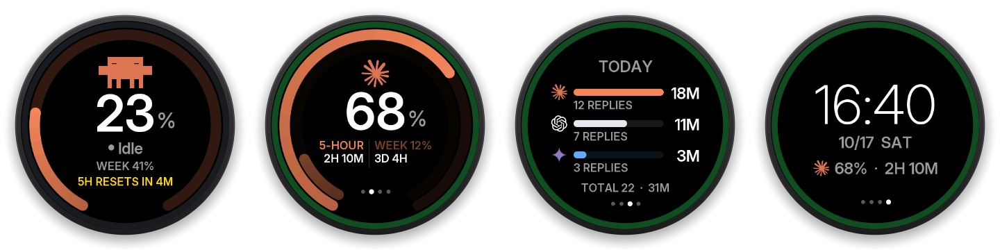

# AI 狀態指示燈（AIMonitor）

一塊插在 USB 上的小圓螢幕，顯示 **Claude / ChatGPT / Gemini** 現在在做什麼（生成中、等你允許、完成、出錯），以及額度用了多少。

## 怎麼看

| 外圈燈號 | 意思 |
|---|---|
| 🟢 綠色慢呼吸 | 正在生成 |
| 🟡 黃色快呼吸 | 等你允許或回答 |
| 🟢 綠色恆亮 | 完成（背景完成的會一直亮到你去看） |
| 🔴 紅色雙閃 | 出錯或額度用完 |
| ⚪ 暗灰 | 待命 |

- **內圈與大數字**：5 小時額度用了幾 %，到提醒門檻（預設 90%）變紅；`WEEK` 是每週額度，最下面是重置倒數。
- **下方小圓點**：其他對話的狀態。
- **同時有好幾個對話時**，優先顯示你還沒看到的事（等你允許 > 出錯 > 完成 > 生成中）。
- **換頁**：BOOT 鍵短按（AMOLED 左右滑）：狀態 → 額度詳細 → 今日統計 → 時鐘。
- **標為已讀**：長按 BOOT 鍵（AMOLED 按住螢幕）。
- 待命 5 分鐘進入時鐘螢幕保護，AI 一有動靜就回來。

## 需要的東西

- 螢幕（二選一）：
  - **ESP32-2424S012N**（1.28 吋 LCD，便宜）
  - **Waveshare ESP32-S3-Touch-AMOLED-1.75**（1.75 吋 AMOLED，有觸控、自動轉向、會動的 Clawd、WiFi、麥克風）
- USB-C **傳輸線**（只能充電的線不行）
- Windows 10 / 11

## 開始使用

**1. 燒錄韌體（新螢幕只要一次）**

1. 從 [Releases](https://github.com/Eggisgood69/AIMonitor/releases/latest) 下載韌體：1.28 吋用 `aimon-usb-esp32c3.bin`，AMOLED 用 `aimon-usb-esp32s3-amoled175.bin`。
2. 用 Chrome 開 <https://espressif.github.io/esptool-js/>，接上螢幕按 **Connect**。
   連不上時：按住 BOOT、按一下 RST、放開 BOOT，再試一次。
3. Flash Address 填 **0x0**，選剛下載的檔案，按 **Program**。完成後按 RST，畫面出現 **Not Connected** 就對了。

之後的韌體更新都在 AIMonitor 裡按一下就好。

**2. 安裝 AIMonitor**

1. 從 [Releases](https://github.com/Eggisgood69/AIMonitor/releases/latest) 下載 `AIMonitor.exe`，雙擊執行。
   如果出現「Windows 已保護您的電腦」，按「其他資訊 → 仍要執行」（程式沒有付費簽章）。
2. 在設定視窗**登入 Claude**（要看 ChatGPT / Gemini 的額度也各登入一次）。
3. 插上螢幕，按「播放測試畫面」確認。

之後開機會自動執行，插上螢幕就能用。設定視窗從右下角系統匣圖示打開。

## 偵測得到什麼

- **桌面 App**：Claude、ChatGPT（含 Codex）、Gemini，不用另外設定。
  - Claude App 5.x 在 **Code 模式**時讀不到一般聊天的狀態，那段時間聊天的燈不亮；切回聊天模式後照側邊欄補上（還在跑 = 生成中、出現藍點 = 完成）。
    新對話剛送出就切走時，App 自己也不會標狀態，這種偵測不到。
- **Claude Code**：設定視窗打開「連接 Claude Code」（會在 `~/.claude/settings.json` 加入 hooks，關掉就移除）。
- **網頁版**（claude.ai、chatgpt.com、gemini.google.com）：要裝附的瀏覽器擴充功能。
  Chrome 開 `chrome://extensions` → 開「開發人員模式」→「載入未封裝項目」→ 選 `%LOCALAPPDATA%\AIMonitor\extension`（設定視窗有按鈕直接打開）。
- 只看畫面上的「停止」「允許」按鈕，**不讀對話內容**，資料只在你的電腦裡。

## 選用功能

- **好幾塊螢幕**：可以同時接，內容一樣，亮度 / 方向各自設定。
- **AMOLED 用 WiFi**：設定視窗「WiFi」分頁選網路、輸入密碼，之後接充電器就能顯示，不用插電腦（只支援 2.4 GHz）。韌體更新也可以經 WiFi。
- **AMOLED 當 USB 麥克風**：設定視窗把「麥克風」打開，電腦會多一支「AIMonitor Mic」，可以用 Win+H 語音輸入；錄音時背景會跟著說話音量淡淡亮起。
- **AMOLED 自訂動畫**：設定視窗「螢幕角色」→「新增影片…」，用自己的影片（最長 8 秒）取代 Clawd。需要先裝 ffmpeg：`winget install Gyan.FFmpeg`。
- **額度重置提醒**：用量到門檻的額度，重置前 5 分鐘和重置時各提醒一次。
- **外接 LED（WS2812）**：讓燈號從外殼透出來。1.28 吋接背面排座：DIN → **RX**、VCC → **3.3V**、GND → **GND**（不要接 IO8 焊點）；AMOLED 的 DIN 接 **GPIO16**。接好後在設定視窗打開「外接 LED」。
- **3D 列印外殼**：設計中，在 [`enclosure/`](enclosure/)。

## 更新

- **AIMonitor**：有新版時設定視窗上方會出現「更新」按鈕，按了才更新（不會自己更新）。
- **螢幕韌體**：設定視窗顯示「可更新」時按「更新螢幕韌體」，約 30 秒。萬一失敗，用上面的網頁燒錄重燒一次就能救回。

## 遇到問題

- 燈號不對：設定視窗最下面「除錯資訊」截圖，加上紀錄檔 `%LOCALAPPDATA%\AIMonitor\aimonitor.log`，開 issue 回報。
- 額度讀不到：網站改版可能讀不到，設定視窗會顯示詳細資訊，截圖回報即可。
- 用網頁燒錄器前，先在系統匣右鍵「結束程式」（序列埠不能兩個程式同時用）。

## 開發

- 建置：`./build.ps1`（需要 Go 1.22+ 與 arduino-cli，詳見 [CLAUDE.md](CLAUDE.md)）。
- 韌體原始碼在 `firmware/aimon/`，電腦端在 `windows/`，序列埠協定與實作細節寫在 [CLAUDE.md](CLAUDE.md)。

## 授權

MIT License，見 [LICENSE](LICENSE)。
螢幕使用的 Inter 字型（`firmware/tools/fonts/Inter-Variable.ttf`，以及由它產生的 `firmware/aimon/fonts.h`、`fonts466.h`）採用 SIL Open Font License 1.1，授權全文見 [firmware/tools/fonts/OFL.txt](firmware/tools/fonts/OFL.txt)。
