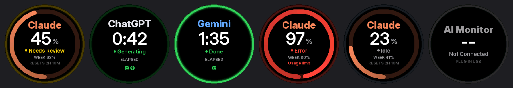
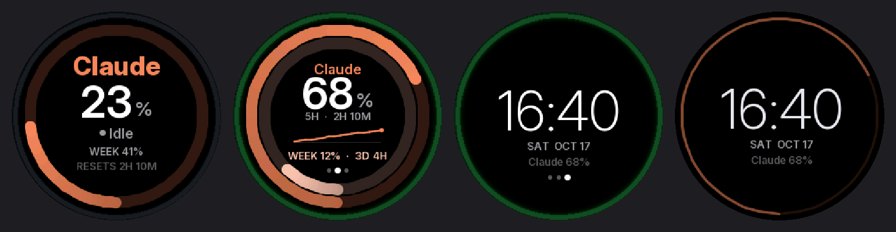

# AI 狀態指示燈（USB 版）

插上 USB 就能用：每台電腦第一次雙擊 `AIMonitor.exe`，之後插上螢幕就會自動顯示**你目前正在用的 AI**（Claude / ChatGPT 桌面 App，或瀏覽器裡的 Claude / ChatGPT / Gemini），不需要 Wi-Fi。



動態效果見 [preview.gif](preview.gif)。

各頁面（BOOT 短按切換：狀態 → 額度詳細 → 今日統計 → 時鐘）與螢幕保護：



Apple Watch 活動圓環風格：純黑底、Apple 系統配色、Inter 字型（抗鋸齒）。

| 最外圈細環（狀態燈） | 意義 |
|---|---|
| 🟢 綠色慢呼吸 | 正在生成 |
| 🟡 黃色快呼吸 | 網頁或 Claude Code 出現「允許 / 確認」，等你處理 |
| 🟢 綠色恆亮（不呼吸） | 完成。在背景完成時，會一直亮到你切回去看（或長按 BOOT） |
| 🔴 紅色雙閃 | 出現錯誤或額度上限訊息（Claude Code 會顯示 RATE LIMIT 等原因） |
| ⚪ 暗灰 | 待命 |

- **內圈**：5 小時額度，下方留一個開口（像儀表），從開口左側開始順時針增加，用量 ≥ 90% 時變紅。中間的 `WEEK 63%` 是每週額度，最下面一行是 5 小時額度的重置倒數。
- **今日統計頁**：今天各 AI 生成了幾次、生成多久（不含等你按允許的時間），每天午夜歸零；設定視窗另有最近 7 天的長條圖。資料存在 `%LOCALAPPDATA%\AIMonitor\stats.json`。
- **額度詳細頁**：外環 5 小時、內環本週，中間是最近 5 小時的用量折線。
- **中間大數字**：有額度資料時顯示用量 %；沒有時顯示這個狀態已經持續多久。
- **6 點鐘缺口的小圓點**：其他對話的狀態，排在額度環下方的缺口裡，最多 5 個，只用顏色表示：空心綠圈 = 生成中、綠點 = 完成、黃點 = 需審核、紅點 = 錯誤（要你處理的排在左邊）。
- **顯示哪一個 AI**：「你沒看到的事」優先，你正在看的對話自己看得到：
  1. 背景需審核 → 2. 正在看的需審核 → 3. 背景錯誤 → 4. 背景完成 → 5. 背景生成中 → 6. 正在看的生成中 → 7. 看過的錯誤 / 完成（亮 8 秒）→ 8. 待機。
  背景的錯誤和完成會一直亮，直到你切過去看或長按 BOOT；背景完成在通知 1 分鐘後會讓位給生成中（你在別的對話來回聊時看得到呼吸燈），等沒有 AI 在跑時再回到主燈。其他狀態顯示在下方小圓點。你切到另一個 AI 的視窗時（例如從 Claude App 切到 Gemini 網頁），主燈跟著你看的那個 AI，只有需審核和錯誤會蓋過它。
- **Windows 通知**：背景發生的錯誤、完成，以及 7 秒還沒處理的需審核，各跳一次通知。
- **螢幕方向**：設定視窗的「螢幕方向」可選 0° / 90° / 180° / 270°，螢幕會記住（下次插電直接是這個方向）。
- **BOOT 鍵**：短按翻頁（狀態 → 額度詳細 → 今日統計 → 時鐘，20 秒後自動回到狀態頁）；長按 0.7 秒把綠燈、紅燈標為已讀。亮度在 AIMonitor 設定視窗調整。
- **螢幕保護**：連續 5 分鐘待命（或未連線）會變成時鐘畫面並調暗背光，時鐘（連同日期和額度）整組置中，日期以數字顯示（例如 10/17 SAT）。AI 一開始生成、需要審核或出錯就會立刻回來，按 BOOT 鍵也可以叫醒。時間可以在 AIMonitor 設定視窗的「螢幕保護」選單調整（也可以關閉）；亮度在 `firmware/aimon/config.h` 的 `SAVER_BRIGHT`。

---

## 需要的硬體

| 項目 | 說明 |
|---|---|
| 螢幕板 | **ESP32-2424S012N**：ESP32-C3 + 1.28 吋圓形 IPS 螢幕（GC9A01，240×240）。網路商店搜尋「ESP32-2424S012」或「ESP32-C3 1.28 圓形螢幕」即可找到 |
| USB 線 | USB-C **傳輸線**（只能充電的線電腦抓不到裝置） |
| 電腦 | Windows 10 / 11（需要 WebView2，Windows 11 已內建） |

- 型號最後的 **N** 是無觸控版，本專案就是用這個版本開發與測試；觸控版（**C**）螢幕相同，但沒有實測過。
- 不需要焊接、不需要外接零件：板子上的 **BOOT 鍵**就是操作按鈕（短按翻頁、長按標為已讀），**RST 鍵**用來重新開機。
- 不需要 Wi-Fi：螢幕的電源和資料都走同一條 USB。

## 一、燒錄韌體（只要一次）

### 方法 A：用網頁燒錄（最簡單，不用裝任何東西）

1. 用 Chrome 開啟 <https://espressif.github.io/esptool-js/>
2. 用 USB 接上螢幕，按 **Connect**，選擇裝置。
   - 如果連不上：按住板子的 BOOT 鍵，再按一下 RST 鍵，然後放開 BOOT，再試一次。
3. Flash Address 填 **0x0**，檔案選 `firmware/aimon-usb-esp32c3.bin`，按 **Program**。
4. 完成後按一下 RST 鍵，畫面會出現 **NO LINK / Plug in USB**。

### 方法 B：Arduino IDE

1. 安裝程式庫 **LovyanGFX** 和 **ArduinoJson**（v7）。
2. 開啟 `firmware/aimon/aimon.ino`。
3. Board 選 **ESP32C3 Dev Module**，並把 **USB CDC On Boot** 設成 **Enabled**。
4. 上傳。

PlatformIO 使用者：在 `firmware/` 目錄執行 `pio run -t upload`。

## 二、每台電腦：雙擊 `AIMonitor.exe`（Windows）

1. 雙擊 `windows/AIMonitor.exe`。
   - 如果出現「Windows 已保護您的電腦」：按「**其他資訊** → **仍要執行**」。這是因為這個程式沒有付費數位簽章。
2. 它會自動安裝到 `%LOCALAPPDATA%\AIMonitor`，並設定成開機自動執行，然後打開設定視窗。
3. 在設定視窗按「**登入 Claude**」，登入一次就好（建議用 Email 登入）。登入後就會自動在背景查詢額度。
4. 插上螢幕，設定視窗會顯示「已連線（COMx）」。按「播放測試畫面」確認一下。

之後這台電腦**插上螢幕就能用**：開機時程式會自動在背景執行，螢幕拔掉再插也會自動重新連線。

- **系統匣圖示**：右下角的圓形圖示會跟著狀態變色（外圈 = 狀態燈、中間 = 目前的 AI），滑鼠停上去可看到狀態與額度。左鍵打開設定視窗，右鍵有選單（播放測試畫面、重新讀取額度、結束程式）。Windows 11 第一次可能藏在「^」裡，可以把它拖到工作列上。
- **再打開設定視窗**：點系統匣圖示，或再雙擊一次 AIMonitor.exe。關閉視窗只是隱藏，程式不會結束。
- **換電腦**：把 `AIMonitor.exe` 放在隨身碟或雲端硬碟，到新電腦雙擊一次、登入一次即可。
- **偵測範圍**：Claude 桌面 App、ChatGPT 桌面 App，以及 Chrome / Edge / Brave / Firefox 裡的 claude.ai、chatgpt.com、gemini.google.com 分頁。
- **不需要**安裝 Chrome 擴充功能。如果之前有裝，請到 `chrome://extensions` **移除**它，否則兩邊會搶同一個 USB 序列埠。

### Mac 或不想裝 exe：Chrome 擴充功能（選用）

`extension` 資料夾是舊的 Chrome 擴充功能版本，Mac 也能用，但只偵測得到 Chrome 分頁。安裝方式：到 `chrome://extensions` 開啟開發人員模式 → 載入未封裝項目 → 選 `extension` 資料夾 → 在跳出的頁面配對螢幕。**不要和 AIMonitor.exe 同時使用。**

## 額度（三家都支援）

在 AIMonitor 設定視窗分別登入一次（登入會記住）：

| | 資料來源 | 內容 |
|---|---|---|
| Claude | claude.ai 用量頁面的資料 | 5 小時、本週 % 與重置時間 |
| ChatGPT | chatgpt.com 方案用量（與 Codex 共用的用量視窗） | 5 小時、本週 % 與重置時間 |
| Gemini | gemini.google.com/usage「用量限制」頁面 | 目前用量、每週上限 % 與重設時間 |

這些都是網站內部、非公開的資料，網站改版時可能需要調整；讀不到時設定視窗會顯示「詳細資訊」，截圖給開發者即可。Google 有時會擋內建瀏覽器的登入，若 Gemini 登不進去請回報。

## Claude Code（終端機 Agent 模式）

在設定視窗打開「**連接 Claude Code**」，AIMonitor 會在 `~/.claude/settings.json` 加入 Claude Code 官方的 hooks（http 類型，送到 `http://127.0.0.1:47322/cc`；修改前會備份成 `settings.json.aimonitor-backup`，關掉開關就會移除）。之後新開的 Claude Code 工作階段：

- 送出任務 → 綠色呼吸（生成中）
- 要你允許執行指令 / 修改檔案 → 黃燈
- 完成 → 綠燈亮 5 分鐘（終端機無法判斷你有沒有在看）
- 也會算進今日統計（Claude）

需要較新版的 Claude Code（支援 http hooks）。AIMonitor 沒在執行時，hooks 連不上只會被略過，不影響 Claude Code 工作。

## 額度重置提醒

用量曾經達到門檻（預設 90%，可在設定視窗調整或關閉）的額度，會在**重置前 5 分鐘**和**重置當下**各提醒一次：Windows 右下角跳通知，螢幕下方顯示黃字 `5H RESETS IN 4M` / 綠字 `5H QUOTA RESET`（螢幕保護中會自動叫醒）。5 小時與每週額度都適用，Claude、ChatGPT、Gemini 都支援。

## 更新螢幕韌體

AIMonitor 內建最新韌體。設定視窗「韌體」一欄顯示「可更新」時按「更新螢幕韌體」，大約 30 秒，螢幕會自動重新開機。不需要再用網頁燒錄器。
（萬一更新失敗、螢幕沒反應：用「一、燒錄韌體」的網頁燒錄方式重燒 `aimon-usb-esp32c3.bin` 即可救回。）

## 偵測原理與限制

- 程式用 Windows 內建的 UI Automation，讀取 App 和瀏覽器畫面上的「停止」、「允許」按鈕來判斷狀態（不會截圖，也不會讀取對話內容）。這些網站或 App 改版時，偵測可能失效。設定視窗裡每個項目都有「偵測到的按鈕」可以展開，把它截圖給開發者，就能調整規則（規則在 `windows/monitor.ps1` 最上方）。
- 瀏覽器只偵測得到每個視窗**目前顯示的分頁**。在 AI 分頁問了問題後切到別的程式沒關係，但如果同一個視窗切到別的分頁，就看不到那個 AI 分頁了。
- 同一個 USB 序列埠不能同時被兩個程式使用。用網頁燒錄器時，先在設定視窗按「結束程式」，燒完再雙擊 AIMonitor.exe（用 AIMonitor 內建的更新則不需要）。
- 程式紀錄檔：`%LOCALAPPDATA%\AIMonitor\aimonitor.log`

## 序列埠協定（自己寫程式控制也可以）

115200 baud，每行一個 JSON：

```json
{"ai":"claude","st":"review","msg":"","p5":45,"pw":63,"r5":1792226358,"age":12,"now":1792218000,"o":[["chatgpt","done"]]}
```

- `ai`：`claude` / `chatgpt` / `gemini` / `none`
- `st`：`idle` / `done` / `working` / `review` / `error`
- 螢幕 20 秒沒收到資料，會自動顯示 NO LINK。
- 送出 `{"hello":1}` 會收到 `{"aimon":2}`；按下 BOOT 鍵時，螢幕會送出 `{"ev":"btn"}`。

## 檔案

```
firmware/aimon-usb-esp32c3.bin  已編譯好的完整韌體（從 0x0 燒錄）
firmware/aimon/                 原始碼（aimon.ino 主程式、ui.h 畫面、fonts.h 字型、config.h 亮度與腳位）
firmware/tools/fontgen.py       重新產生字型（Inter, SIL OFL）
firmware/preview/               重新產生 README 的預覽圖片（`build-preview.ps1`，開發用）
windows/AIMonitor.exe           Windows 程式（每台電腦雙擊一次）
windows/                        程式原始碼（Go；monitor.ps1 是畫面偵測規則）
extension/                      Chrome 擴充功能（選用，Mac 用）
```

## 授權

MIT License，見 [LICENSE](LICENSE)。
螢幕使用的 Inter 字型（`firmware/aimon/fonts.h`）採用 SIL Open Font License，不在 MIT 範圍內。
