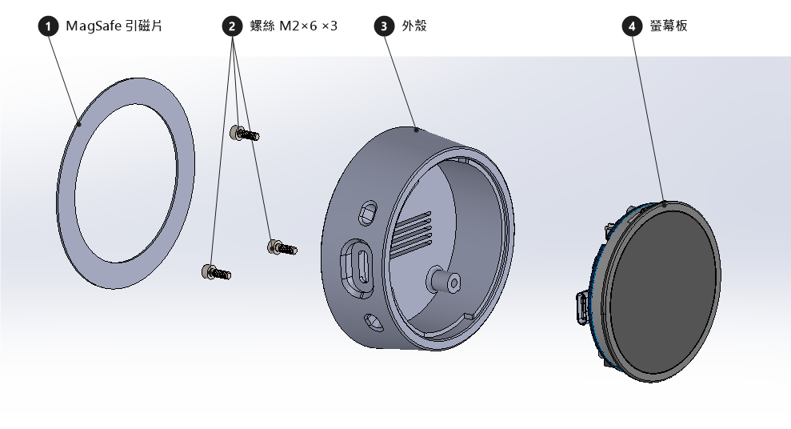

# 1.75 吋 AMOLED 版外殼（SolidWorks，設計中）

給 Waveshare ESP32-S3-Touch-AMOLED-1.75 用的外殼。1.28 吋版在 [`../lcd128/`](../lcd128/)。
資料夾結構與命名規則見上一層 [README](../README.md)。

| 位置 | 內容 | 公開 |
|---|---|---|
| `*.SLDPRT` / `*.SLDASM` | 原始檔（零件、組合件） | ✓ |
| `export/` | 匯出的列印檔（3MF / STL）與 STEP | ✓ |
| `reference/` | Waveshare 官方的板子 3D 模型（STEP） | ✓ |

## 爆炸視圖

| # | 零件 | 檔案 | 備註 |
|---|---|---|---|
| 1 | MagSafe 引磁片 | `magsafe_ring.SLDPRT` | 買來的，不用印 |
| 2 | 螺絲 M2×6 ×3 | — | 買來的 |
| 3 | 外殼 | `oledcase.SLDPRT` → `export/oledcase.3mf` | 3D 列印 |
| 4 | 螢幕板（Waveshare ESP32-S3-Touch-AMOLED-1.75） | `reference/ESP32-S3-Touch-AMOLED-1_75.stp` | 買來的 |

## 要量的尺寸

官方模型不一定跟手上的板子完全一樣，畫外殼前用游標卡尺對一下。
已知差異：`reference/` 的 Waveshare STEP 是有 GPS 的版本（背面有 Quectel L76 模組 `GPS1` 和 U.FL 天線座），
手上這塊**沒有 GPS**，那一塊不用替它留空間；組合件裡可以把 `GPS1_ASM` 隱藏或抑制。

| 項目 | 備註 |
|---|---|
| PCB 外形與厚度 | |
| 螢幕玻璃直徑、可視區直徑 | 前面有觸控玻璃 |
| 玻璃表面到 PCB 正面的高度 | 決定前框深度 |
| PCB 背面最高零件高度 | USB-C 座、排座、電池座 |
| USB-C 位置與插頭外殼尺寸 | 插頭外殼約 12.5 × 7 mm，長度含護套約 20-25 mm |
| 按鍵位置與高度 | BOOT 是操作按鈕（短按翻頁、長按標為已讀），外殼要能按得到 |
| 排座位置 | 選配 WS2812 LED 接排座的 GPIO16 / 3V3 / GND |
